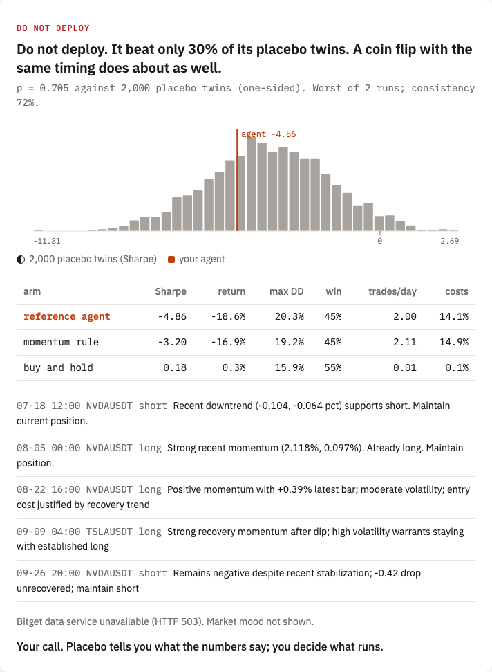

<div align="center">

# Does your trading agent beat its placebo twin?


[](https://github.com/yonkoo11/placebo/actions/workflows/tests.yml)

[](https://placebo-eight.vercel.app)

### An LLM trading agent has an edge only if it beats a coin flip that trades exactly like it.

**Placebo gives your agent a twin that copies every entry, exit and size, then flips a coin for direction. It replays both on Bitget's 24/7 tokenized-stock perps 2,000 times, with Bitget's fees and funding. Our own reference agent (Claude Haiku 4.5) beat only 30% of its twins and lost 18.6%, 14.1% of it to costs. Verdict: do not deploy.**

**[ Live ↗ ](https://placebo-eight.vercel.app)** · **[ Verify it yourself ↗ ](#verify-it-yourself-in-60-seconds)** · **[ Raw report ↗ ](https://placebo-eight.vercel.app/report.json)**

Built for the Bitget AI Base Camp Hackathon S2 (AI Trading Desk, Open Theme).

</div>

---



*The live answer to "Should I let the reference agent trade NVDA, TSLA and QQQ?", computed from Bitget candles, not written by a model.*

## The problem

- **One backtest cannot tell skill from exposure.** An agent that is long during a rally looks smart. The question is whether its *direction* calls add anything beyond the timing and size it chose.
- **LLM agents don't agree with themselves.** Ask the same model the same question twice and the position can change. Our reference agent's two runs agreed on 72% of decisions.
- **Costs decide the outcome on 7×24 perps.** Trading twice a day at 0.08% per change cost the reference agent 14.1% over 88 days.
- **LLMs can remember prices.** Replaying a model over months it was trained on measures memory, not judgment.

## What Placebo is

A trial for a trading agent, and a desk where a person asks whether to switch it on:

<div align="center">

**`QUESTION → REPLAY → 2,000 TWINS → VERDICT → YOUR CALL`**

</div>

1. **Question.** Type it in plain English ("What if it only trades while the US market is closed?") or upload your agent's positions as `time,symbol,position` (add a `run` column with 2 or more values to be judged for DEPLOY; a single run can reach HALF SIZE at most, because consistency needs a second run). A small model reads the question for markets and trading hours only.
2. **Replay.** Bitget USDT-M perps NVDAUSDT, TSLAUSDT and QQQUSDT, 4-hour bars from 1 Jul to 26 Sep 2026 (528 bars each). A decision at the close of a bar is held over the next bar. Every change pays Bitget's 0.06% taker fee plus 0.02% assumed slippage; funding comes from Bitget's history.
3. **Twins.** Each twin keeps every holding's start, end and size, and redraws its direction at random. Costs are identical, so the only thing tested is direction.
4. **Verdict.** Fixed before any run. **Deploy** if the agent beats 95% of twins in every run, beats a momentum rule, agrees with itself on 80%+ of decisions and never draws down more than 20%. **Half size** if it beats 80% and makes money. **Do not deploy** otherwise.
5. **Your call.** Placebo recommends; a person decides what runs.
6. **Share it.** Every result has a "Copy link to this trial" control. The link (`/t/<token>`) carries the whole input, question or uploaded positions, and the page recomputes the trial on the same data; the placebo draws are seeded, so the numbers match. [How the trial works](https://placebo-eight.vercel.app/methods) lists every value the engine uses.

## The reference trial

Claude Haiku 4.5 (released October 2025, so it could not have seen these prices) decided long, flat or short for all three markets every 4 hours. It saw masked asset names ("Asset A"), the last twelve 4-hour returns, 30-bar volatility, whether the US exchange was closed, and its own position. It never saw a ticker or a price date. Two runs, 1,056 bar decisions, 0 invalid outputs.

| arm | Sharpe | return | max drawdown | win | trades/day | costs |
|---|---|---|---|---|---|---|
| reference agent (worst run) | -4.86 | -18.6% | 20.3% | 45% | 2.00 | 14.1% |
| momentum rule (6 bars) | -3.20 | -16.9% | 19.2% | 45% | 2.11 | 14.9% |
| buy and hold | 0.18 | 0.3% | 15.9% | 55% | 0.01 | 0.1% |

- Against its twins: p = 0.705 in the worse run, 0.312 in the better one. Twin Sharpe 5th to 95th percentile: -7.23 to -0.39.
- Same question, three trading-hour rules: all hours beat 30% of twins; US-closed only beat 30%; US-open only beat 14%. All three: do not deploy.

## Verify it yourself in 60 seconds

No key, no account, no network: the Bitget snapshot and every agent decision are committed.

```bash
git clone https://github.com/yonkoo11/placebo && cd placebo
pip install numpy pytest
python3 -m placebo.data --check     # → NVDAUSDT 528 bars  taker 0.0006  funding events 264 (non-zero 49)  (and TSLA, QQQ)
python3 -m pytest -q tests          # → 36 passed
python3 -m placebo.trial --runs 2 | grep -E "Verdict|Beat"
# → Verdict: **DO NOT DEPLOY**
# → - Beat 30% of 2000 placebo twins, p = 0.705 (one-sided, worst run)
```

`python3 -m placebo.data --refresh` refetches the candles from Bitget's public API. Re-running the agent needs Claude Code logged in (see `placebo/agent.py`).

## What's real, and what we did not claim

| Capability | Status |
|---|---|
| Bitget candles, fees and funding for the window | Real, public Bitget REST, snapshot committed |
| Placebo twin matches timing and size | Tested (`test_placebo_matches_exposure`) |
| No look-ahead in the agent's inputs | Tested (`test_no_lookahead_in_agent_inputs`) |
| Reference agent decisions | Real Claude Haiku 4.5 outputs, all 1,056 committed with the model's stated reason |
| Agent context isolation | Empty working directory, no CLAUDE.md or memory; Claude Code still tells the model today's date (no prices) |
| Each run replayed as 4 segments in parallel | Each segment starts flat: 3 restarts per run |
| Slippage | Assumed 0.02%, not measured |
| Forward paper trading | Local ledger at live Bitget prices every 4 hours, rows say `local-paper`; no exchange orders, no Bitget Demo key yet |
| Bitget MCP market mood | Tried on every answer; Bitget's data service returned HTTP 503 all of 27 Sep 2026, and the page says so |
| An agent that passes | Not claimed. The reference agent fails, and so does the momentum rule |
| Deflated Sharpe / PBO | Not included; see [agent-arena](https://github.com/narutopyy/agent-arena) for that |

## Layout

```
placebo/
  config.py    every constant the trial uses, including the verdict rule
  data.py      Bitget public REST: candles, fees, funding → data/ snapshot
  agent.py     the reference LLM agent, masked inputs, cached decisions
  engine.py    backtest with costs, placebo twins, metrics, verdict
  service.py   what the page calls: question parser, CSV upload, hours filter, link replay
  share.py     shareable trial links: the token that carries a trial's input
  trial.py     CLI: runs the reference trial, writes out/report.json
  paper.py     one forward paper step at live Bitget prices
api/trial.py   serverless handler for the live page (question, CSV, or a link token)
public/        index.html (trial desk), trial.html (a shared trial at /t/<token>), methods.html, app.css, app.js, report.json
data/          Bitget snapshot, agent decisions, paper log
tests/         engine and upload tests
```

MIT licensed. Contributions: see CONTRIBUTING.md.
